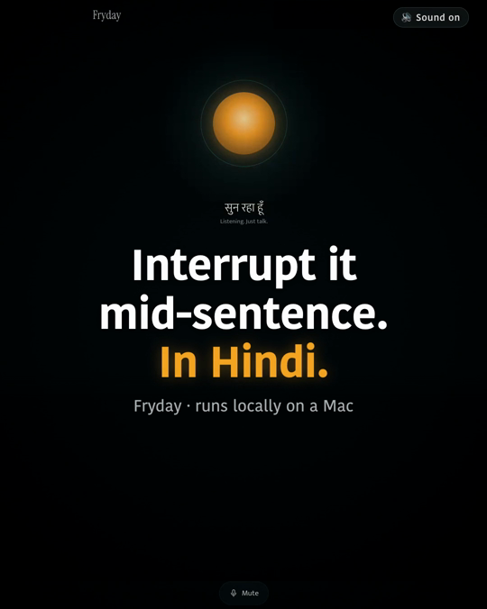
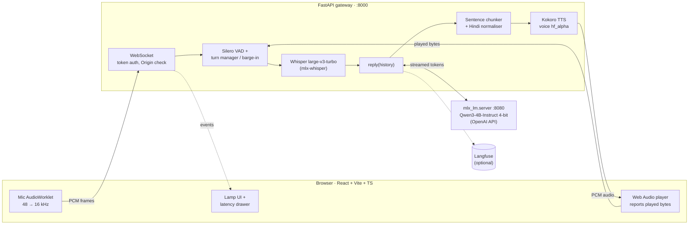

<div align="center">

# Fryday

**A hands-free Hindi/Hinglish voice assistant that runs entirely on your Mac.**<br/>
Talk to it in the browser, interrupt it mid-sentence, and it forgets the words you never heard.

[](https://github.com/Analyst-Harsh/Fryday/actions/workflows/ci.yml)


<!-- TODO(owner): replace the href below with the video URL GitHub gives you after
     dragging fryday-hero-v3.mp4 into an issue/PR comment (or the LinkedIn post URL). -->
<a href="https://github.com/Analyst-Harsh/Fryday">
  
</a>

<sub>▶ Watch the demo: real mic, laptop speakers, no cloud.</sub>

</div>

---

## ✨ Highlights

- 🎙️ **Hands-free Hindi.** Just talk. Silero VAD ends your turn after 500 ms of silence. Whisper writes Hinglish in Devanagari.
- ✋ **Barge-in that forgets what you didn't hear.** Interrupt Fryday mid-reply. The browser reports how much audio actually played, and the server trims the reply in history to that point.
- 🔒 **Fully local.** Speech-to-text, the LLM and text-to-speech all run on Apple silicon via MLX. No cloud APIs. Tracing to Langfuse is optional and off by default.
- ⚡ **Streaming end to end.** LLM tokens stream into a sentence chunker with a short first chunk, so Fryday starts speaking before the reply is finished.
- 📏 **Honest latency.** About **2.8 s voice→voice as a listener hears it**, measured on a recording, not just a server timer (see Performance below).

## 🏗️ Architecture (today)



### Life of a turn

1. The browser's AudioWorklet captures the mic, downsamples 48 → 16 kHz and streams PCM over the WebSocket.
2. Silero VAD hears 500 ms of silence and ends the turn.
3. Whisper large-v3-turbo transcribes it, with Hindi forced so Hinglish comes back in Devanagari.
4. `reply(history)` streams tokens from Qwen3-4B through `mlx_lm.server`'s OpenAI-compatible API.
5. The chunker cuts a short first chunk (a clause or a few words), then whole sentences. The normaliser turns numbers, ₹ and % into Hindi words.
6. Kokoro speaks each chunk, and the audio streams back to the browser's scheduled Web Audio player.
7. If you talk over it, playback stops, the browser reports the bytes it played, and the server trims history to what you heard (`reply_trimmed`).

| Component | Tech | Why |
|---|---|---|
| Client | React + Vite + TypeScript, AudioWorklet, Web Audio | Low-latency capture and gap-free scheduled playback |
| Gateway | FastAPI WebSocket, protocol v1 | Token auth in the first message, Origin check, versioned frames, close codes, newest tab wins, bounded upstream queue, `/healthz` + `/readyz`, graceful shutdown |
| Endpointing | Silero VAD | Small and fast; hands-free turns without a button |
| STT | Whisper large-v3-turbo (mlx-whisper) | Strong Hindi; turbo decoder keeps ASR around 0.5 s warm |
| LLM | Qwen3-4B-Instruct-2507, 4-bit, `mlx_lm.server` | Fits a 16 GB Mac; the OpenAI API means the server can be swapped (vLLM later) without touching callers |
| TTS | Kokoro-82M (mlx-audio), voice `hf_alpha` | Apache-2.0, fast, has a Hindi voice (picked blind by ear) |
| Observability | structlog, Langfuse (opt-in) | Structured per-turn logs; traces only when keys are set |

## 🚀 Quickstart

**You need:** macOS on Apple silicon, [uv](https://docs.astral.sh/uv/) (it installs Python 3.12), and Node.js for the web build. Docker is not needed to run Fryday.

```sh
make sync                    # install every workspace member + dev tools
cp .env.example .env         # then set FRYDAY_ACCESS_TOKEN:
uv run python -c "import secrets; print(secrets.token_urlsafe(32))"
make web-build               # build the React app into web/dist

make llm                     # terminal 1: Qwen3-4B on :8080 (first run downloads it)
make serve                   # terminal 2: gateway + web app on :8000
```

Open **http://127.0.0.1:8000**, paste the token, allow the mic and start talking. Headphones are recommended (see Limitations below).

**Terminal modes** (also need `make llm`): `make talk` for push-to-talk voice (`FRYDAY_HANDS_FREE=1` for hands-free) and `make chat` for text chat.

<details>
<summary><b>All make targets</b></summary>

| Target | Does |
|---|---|
| `make sync` | Install all workspace members and dev tools |
| `make llm` | Local model server (MLX, port 8080) |
| `make serve` | WebSocket gateway + built web UI on :8000 (needs `FRYDAY_ACCESS_TOKEN`) |
| `make talk` / `make chat` | Terminal voice chat (push-to-talk) / terminal text chat |
| `make web` | React dev server on :5173 (proxies `/ws` to `make serve`) |
| `make web-build` / `make web-test` | Build `web/dist` / run the frontend tests |
| `make test` / `make lint` | pytest / ruff format check, ruff lint, pyright (strict) |
| `make up` / `make down` / `make db-check` | Postgres 16 + pgvector via Compose; groundwork, not used by the app yet |

Config lives in [`app/src/fryday/config.py`](app/src/fryday/config.py); every field can be overridden with a `FRYDAY_<NAME>` env var. See [`.env.example`](.env.example).
</details>

## 📊 Performance

Real mic, Chrome, MacBook speakers, M-series Mac, warm models ([EXPERIMENTS, 2026-10-25](docs/EXPERIMENTS.md)).

| Metric | Result |
|---|---|
| **Voice→voice, as heard** (end of your voice → start of Fryday's, measured in the recording) | **~2.8 s** median (2.3–3.3 s) |
| Server "you stop → Fryday speaks" (incl. the 500 ms VAD wait), 10 warm turns | 1.97 s median (1.57–2.65 s) |
| Gap between the two | a listener hears ~0.7–0.8 s more than the server measures |

Stage breakdown, 8 warm turns over the browser path (synthetic-speech mic, [EXPERIMENTS, 2026-10-22](docs/EXPERIMENTS.md)): ASR **0.54 s**, LLM first token **0.23 s**, first audio from reply start **1.15 s** (medians). Small samples; p95 over 20+ turns is not measured yet.

## 🗺️ What's next

Next up is **LLM hosting and tuning**, then back to tools and agents. Full plan: [learning roadmap](docs/plan/00-learning-roadmap.md).

| | Step |
|---|---|
| ✅ | Local LLM behind an OpenAI API, streaming, sampling |
| ✅ | Speech in and out: Whisper, Kokoro, Hindi normaliser |
| ✅ | Real-time browser turn: WebSocket, VAD, barge-in, latency |
| 🔜 | A tiny GPT from scratch, then a **mini-vLLM** on it: KV cache, paged KV, continuous batching, prefix caching |
| ⏳ | LLM serving internals + **vLLM** |
| ⏳ | **Triton Inference Server**: ONNX, dynamic batching, an LLM via a decoupled streaming backend, ensembles |
| ⏳ | **Quantisation**: a hand-written int8/int4 quantiser; MLX 4/8-bit on an eval |
| ⏳ | **Fine-tuning**: LoRA + DPO on the Mac for a Hindi voice-reply style |
| ⏳ | **GPU sprints**: a CUDA kernel, vLLM on CUDA, multi-LoRA, TensorRT-LLM + Triton |
| ⏳ | **Tools and agents by voice**: tool calling, memory/RAG, approvals |

## ⚠️ Limitations

- **No tools yet.** Fryday can't look anything up, so it may make up live facts (it has invented the weather).
- **A 4B model.** Replies are short and friendly but not always right; it has also slipped emoji into replies, which the normaliser doesn't strip yet.
- **Laptop speakers can cause self-interruption.** Fryday may hear itself and barge in on its own reply. Not measured yet; use headphones.
- **Mac-only today.** MLX needs Apple silicon. One user, one static token, localhost only (no TLS).

## 📁 Repo layout

```
app/      Python package `fryday`: voice pipeline + FastAPI gateway (tests in app/tests)
web/      Browser client: React + Vite + TypeScript
docs/     HLD, roadmap, experiments, runbook, learning notes
spikes/   Small learning scripts (attention, tokens, audio, latency budget)
infra/    Files Compose mounts (Postgres init)
```

**Quality gates:** CI runs ruff, pyright (strict) and pytest, plus a web job (tsc, vitest, vite build). Model backends sit behind typed seams with contract tests, so CI never runs real models. Lefthook runs format, lint and gitleaks before each commit, and the full suite before each push.

## 📚 Docs

- [High-level design](docs/specs/2026-10-04-fryday-hld-design.md) · [Architecture overview](docs/specs/2026-10-04-fryday-architecture.md)
- [Learning roadmap](docs/plan/00-learning-roadmap.md) · [Experiments log](docs/EXPERIMENTS.md)
- [Runbook](docs/RUNBOOK.md) · [Security](SECURITY.md) · [Production gaps](docs/learn/production-gaps.md)

Fryday is also how I'm learning AI engineering in depth; the journal lives in [`docs/learn/`](docs/learn/LEARNING.md).
